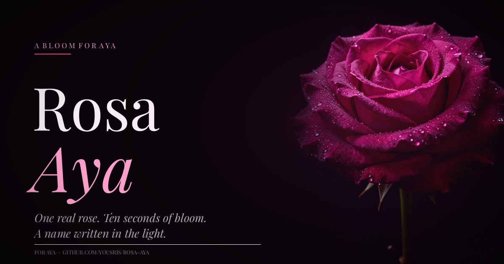

# Rosa Aya 🌹

**A bloom for Aya — one real rose, a ten-second film, and a name hidden in the light.**

A small, single-page digital botanical study built as a gift for **Aya**. No frameworks, no build step, no trackers. Just hand-written HTML, CSS, and a little Canvas.



## What's inside

- **A rose that grows from its roots** — the hero rose is revealed bottom-to-top by a hand-drawn SVG root system, then stays aglow. Press *Grow again* to replay it.
- **A real rose** — a photoreal, dew-covered magenta rose generated with [Higgsfield](https://higgsfield.ai), colour-graded and feathered by hand.
- **A 3D bloom film** — ten seconds of the rose opening, rendered frame by frame from the still image (perspective homography, bloom mask, drifting dust, and a quiet dedication at the end).
- **A sealed letter** — press the wax seal to unfold a letter for Aya.
- **A tiny secret** — type `a·y·a` anywhere on the page. ✿

## Tech

- Pure HTML, CSS and vanilla JavaScript — zero dependencies.
- Self-hosted variable fonts: Playfair Display & Karla.
- Canvas 2D for the dust field and the petal easter egg.
- The bloom film is an H.264 MP4 rendered locally with Python, NumPy, Pillow and FFmpeg.
- Respects `prefers-reduced-motion`, keyboard accessible, and responsive from 320 px up.

## Run it locally

```bash
git clone https://github.com/Yousris/rosa-aya.git
cd rosa-aya
python3 -m http.server 8080
```

Then open <http://localhost:8080>.

There is no install step. Any static file server works.

## Deploy on Vercel

This repo is ready for Vercel as a static site — no build step, no environment variables.

1. Open [vercel.com/new](https://vercel.com/new) and import `Yousris/rosa-aya`.
2. Framework preset: **Other**. Leave the build command and output directory empty.
3. Deploy.

`vercel.json` adds clean URLs, long-lived caching for fonts and media, and a few
sensible security headers.

If you rename the Vercel project, update the canonical and Open Graph URLs at
the top of `index.html` to match the new domain.

## Project structure

```
.
├── index.html            # the whole site
├── assets/
│   ├── rose-*.webp|jpg   # responsive rose imagery
│   ├── rose-bloom.mp4    # the 10s bloom film
│   ├── rose-bloom-poster.jpg
│   ├── fonts/            # Playfair Display + Karla (self-hosted)
│   ├── favicon.svg
│   └── grain.png
├── docs/preview.jpg
└── LICENSE
```

## Credits

- Rose image and visual direction: [Higgsfield](https://higgsfield.ai)
- Type: Playfair Display & Karla (SIL Open Font License)
- Made with light, for Aya — by [Yousris](https://github.com/Yousris)

## License

[MIT](LICENSE) — take the code, keep the kindness.
